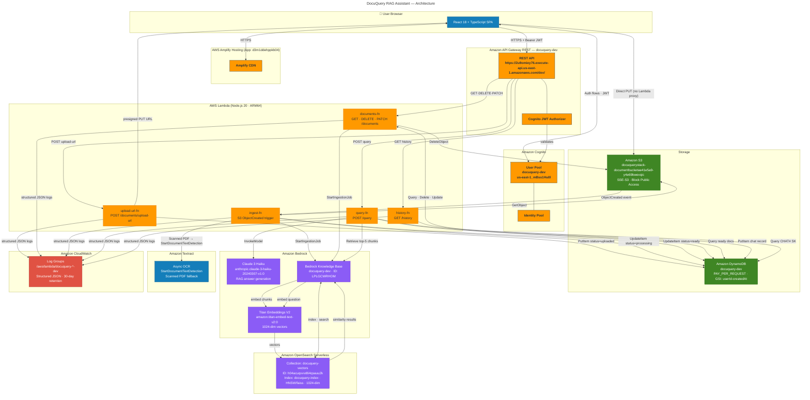

# DocuQuery — Architecture Diagram

This diagram renders natively on GitHub, GitLab, and any Mermaid-compatible viewer.
The raw `.mmd` source is `architecture.mmd` in this folder.

> **Viewing options**
> - **GitHub** — displays automatically in this page
> - **VS Code** — [Markdown Preview Mermaid Support](https://marketplace.visualstudio.com/items?itemName=bierner.markdown-mermaid) extension
> - **Live editor** — paste the source at [mermaid.live](https://mermaid.live)
> - **draw.io** — import the `.mmd` file via Extras → Edit Diagram (select Mermaid)

---

---

## Service Quick Reference

| Service | Resource name | ID / ARN fragment |
|---------|--------------|------------------|
| Cognito User Pool | `docuquery-dev` | `us-east-1_mBss1Hu0l` |
| Cognito App Client | — | `5jgr5ml0r123hmn2blj720r1du` |
| Cognito Identity Pool | — | `us-east-1:3ebd9bf1-a612-4f1f-8a41-8cf46e9cce43` |
| API Gateway | `docuquery-dev` | `https://2u9omiey76.execute-api.us-east-1.amazonaws.com/dev/` |
| S3 Document Bucket | `docuquerystack-documentbucketae41e5a9-y4e69bwevqic` | `arn:aws:s3:::docuquerystack-...` |
| DynamoDB Table | `docuquery-dev` | `arn:aws:dynamodb:us-east-1:800445863339:table/docuquery-dev` |
| Bedrock Knowledge Base | `docuquery-dev` | `LPLGCWRHOM` |
| AOSS Collection | `docuquery-vectors` | `h04acuqvvvd64qsauu2k` |
| Amplify App | `docuquery-dev` | `d3m1ddehppkb04` |
| CloudFormation Stack | `DocuQueryStack` | `arn:aws:cloudformation:us-east-1:800445863339:stack/DocuQueryStack/...` |

## Data Flow Summary

### Upload
1. Browser → `POST /documents/upload-url` → **upload-url-fn** creates presigned S3 URL, writes DynamoDB record (`status=uploaded`)
2. Browser → `PUT` directly to S3 (no Lambda proxy)
3. S3 ObjectCreated → **ingest-fn**: extract text (TXT/DOCX/PDF+Textract) → chunk (1000 tokens/200 overlap) → `StartIngestionJob` → Bedrock KB embeds via Titan → stores vectors in AOSS → DynamoDB `status=ready`

### Query (RAG)
1. Browser → `POST /query` → **query-fn**
2. Check DynamoDB for any `status=ready` document — if none, return informational fallback
3. `KB.Retrieve(question, filter={userId}, top=5)` → AOSS cosine similarity search via Titan embeddings
4. If all scores < 0.5 threshold → return fallback (no Claude call)
5. `InvokeModel(Claude 3 Haiku)` with system prompt + retrieved excerpts (10s timeout)
6. Assemble citations, persist chat record to DynamoDB, return `{answer, citations, isFallback}`
